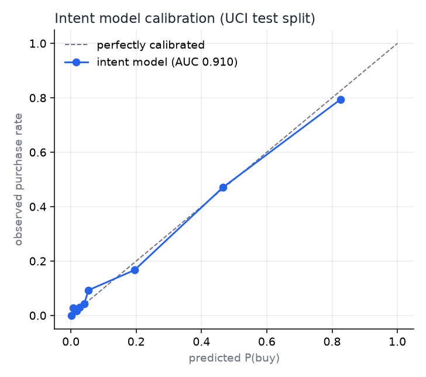
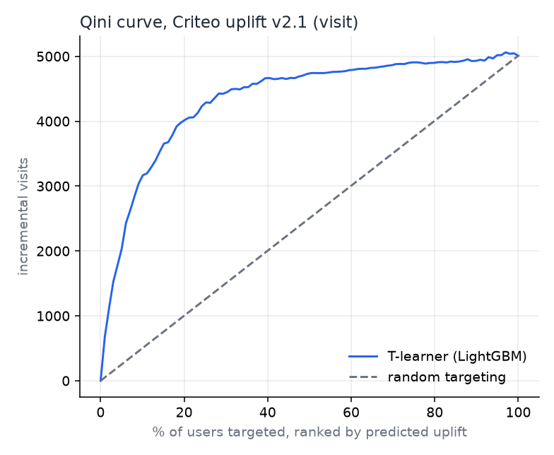
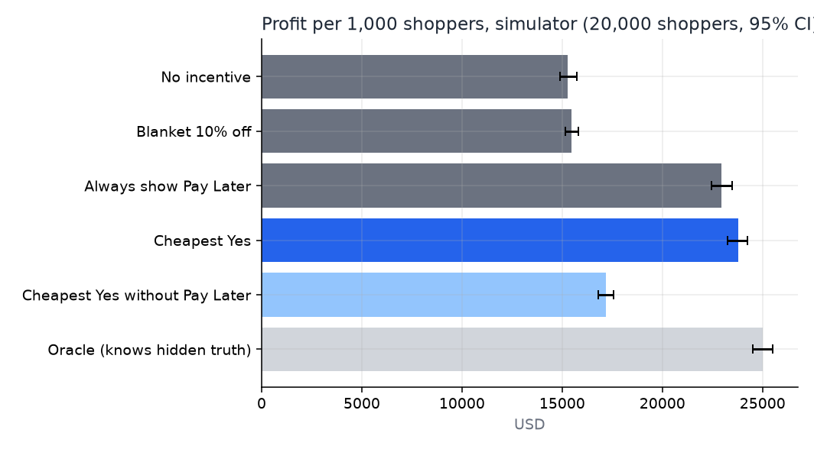

# Evaluation results

Generated by `make eval` on 2026-11-10 20:37 UTC. Regenerate rather than edit.

## 1. Purchase-intent model (public data)

UCI Online Shoppers Purchasing Intention, stratified 80/20 split.

| Metric | Value |
|---|---|
| Test AUC | **0.910** |
| Brier score | 0.0749 |
| Test sessions | 2,466 |
| Purchase rate | 15.5% |

## 2. Uplift method (public data)

Criteo uplift v2.1, random 1,677,452-row sample, 30% held out. Outcome: visit. Same T-learner recipe the store uses. Criteo's treatment is ad exposure, not a checkout incentive, so this validates the method only.

| Metric | Value |
|---|---|
| AUUC vs random targeting | **1.732x** |
| Qini coefficient (per user) | 0.003645 |
| Uplift in top 20% by model | 4.60% |
| Average uplift (everyone) | 1.17% |

## 3. Simulator A/B

20,000 fresh simulated shoppers (seed 2026, never used in training). Each policy is scored on the same shoppers with common random numbers; 95% bootstrap CIs. Profit is after incentive cost, PayPal fees and the Pay Later surcharge. **Simulator results, not field results.**

| Policy | Profit / 1k shoppers | vs no incentive | vs blanket 10% | Conversion | Offer rate | Incentive spend / 1k | Leakage / 1k |
|---|---|---|---|---|---|---|---|
| No incentive | $15,291 (14,901–15,729) | +0 (+0–+0) | -187 (-438–+52) | 34.0% | 0% | $0 | $0 |
| Blanket 10% off | $15,479 (15,141–15,818) | +187 (-57–+435) | +0 (+0–+0) | 47.8% | 100% | $5,929 | $4,276 |
| Always show Pay Later | $22,936 (22,454–23,501) | +7,644 (+7,240–+8,036) | +7,457 (+7,050–+7,822) | 42.3% | 100% | $416 | $166 |
| Cheapest Yes | $23,769 (23,243–24,256) | +8,477 (+8,080–+8,899) | +8,290 (+7,927–+8,668) | 49.8% | 76% | $1,681 | $798 |
| Cheapest Yes without Pay Later | $17,182 (16,809–17,547) | +1,891 (+1,712–+2,063) | +1,704 (+1,525–+1,880) | 45.1% | 69% | $2,347 | $1,413 |
| Oracle (knows hidden truth) | $24,994 (24,504–25,491) | +9,703 (+9,260–+10,127) | +9,516 (+9,131–+9,854) | 54.4% | 100% | $2,005 | $802 |

Leakage = incentive cost spent on shoppers who would have bought with no incentive.

### Ablation: what Pay Later contributes

Removing Pay Later from the ladder changes profit per 1k shoppers from $23,769 to $17,182 (-6,587) and incentive spend from $1,681 to $2,347.

Against simply always showing Pay Later, Cheapest Yes adds +833 USD per 1k shoppers (95% CI +720 to +955). Most of the win is Pay Later itself; the engine adds the rest by spending on paid incentives only where they pay off.

Cheapest Yes picks the same incentive as the oracle (which sees the hidden truth) for 47% of shoppers.

### Mix of choices

| Policy | No incentive | PayPal Pay Later | Free shipping | Free add-on | 5% off | 10% off |
|---|---|---|---|---|---|---|
| No incentive | 100% | 0% | 0% | 0% | 0% | 0% |
| Blanket 10% off | 0% | 0% | 0% | 0% | 0% | 100% |
| Always show Pay Later | 0% | 100% | 0% | 0% | 0% | 0% |
| Cheapest Yes | 24% | 31% | 5% | 12% | 6% | 22% |
| Cheapest Yes without Pay Later | 31% | 0% | 7% | 19% | 15% | 29% |
| Oracle (knows hidden truth) | 0% | 41% | 7% | 10% | 11% | 31% |

### Cheapest Yes choices by hidden archetype

| Hidden archetype | No incentive | PayPal Pay Later | Free shipping | Free add-on | 5% off | 10% off |
|---|---|---|---|---|---|---|
| will_buy_anyway | 55% | 34% | 0% | 6% | 4% | 2% |
| split_payment | 1% | 94% | 0% | 1% | 0% | 3% |
| shipping_hunter | 14% | 16% | 26% | 5% | 15% | 24% |
| price_sensitive | 1% | 9% | 1% | 6% | 4% | 78% |
| bundle_seeker | 6% | 11% | 0% | 64% | 5% | 14% |
| browser | 37% | 17% | 3% | 11% | 9% | 23% |

### Fairness check

| Group | Shoppers | Offer rate | Discount rate |
|---|---|---|---|
| mobile | 11,898 | 77% | 30% |
| desktop | 8,102 | 76% | 25% |
| new visitor | 10,778 | 82% | 34% |
| returning visitor | 9,222 | 70% | 21% |

## Limits

- The store's incentive responses come from a simulator whose archetypes and effect sizes are assumptions. The eval shows the engine recovers those effects from a randomized log and turns them into profit; it does not show what real shoppers would do.
- Browsing behaviour is grounded in real UCI sessions, but cart, hesitation and comparison signals are simulated.
- The simulator A/B ignores the daily budget and per-shopper caps (the live engine enforces both).
- Criteo validates the uplift-modelling recipe on real randomized data, in a different domain (advertising).
